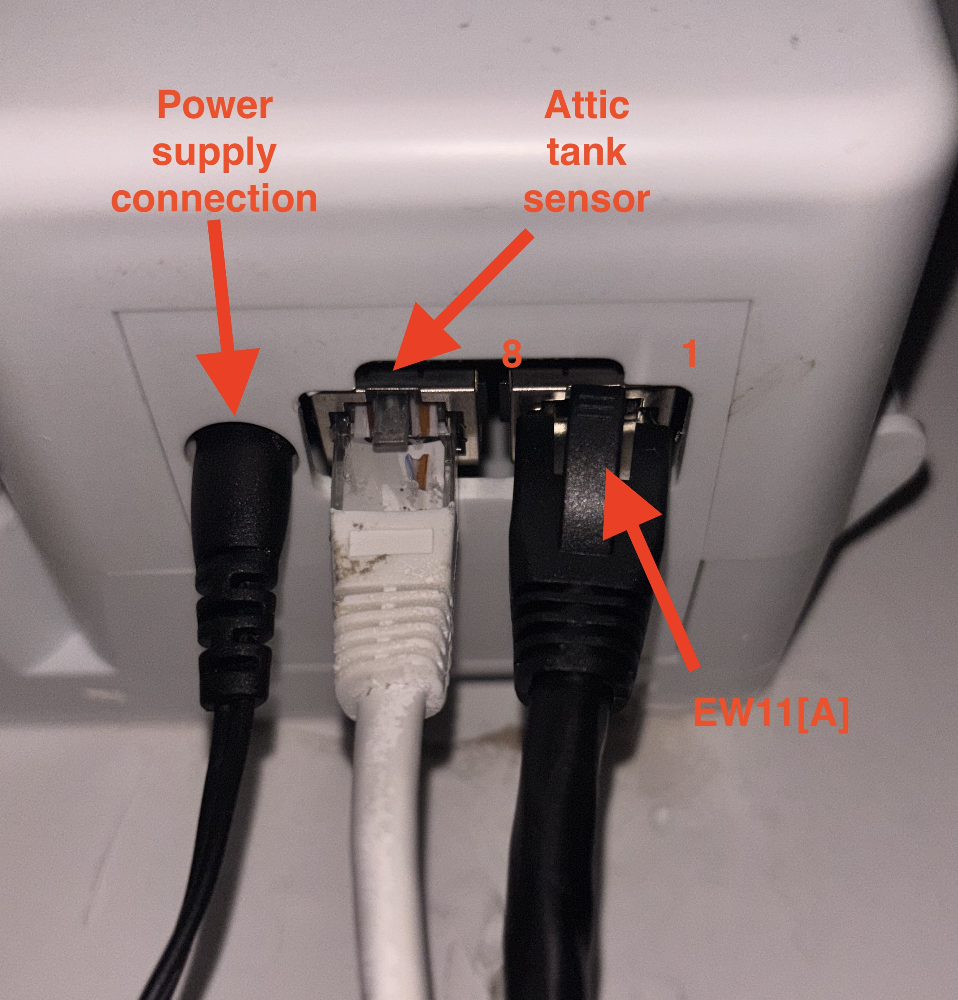
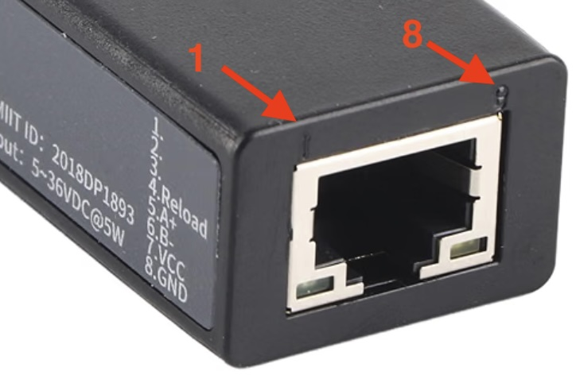

[](https://github.com/davidanderle/hacs-rainwater-harvesting-uk/actions/workflows/hassfest.yml)
[](https://github.com/davidanderle/hacs-rainwater-harvesting-uk/actions/workflows/tests.yml)
[](LICENSE)

# RainWater Harvesting LTD Rain Director — Home Assistant Integration
A Home Assistant Marketplace (formerly HACS) integration for the [Rain Director](https://www.rainwaterharvesting.co.uk/product/rain-director/)
control unit, built on top of a fully reverse-engineered RS485 protocol for system health monitoring purposes.

## 1. Disclaimer
This project is an independent Home Assistant integration and is not affiliated with, endorsed by, or sponsored by RainWater Harvesting LTD. RainWater Harvesting LTD and the RainWater Harvesting LTD logo are trademarks of their respective owners.

## 2. Purpose
This integration exposes **read only** entities that allows one to construct the Rain Director's front-end LED panel ("display"), and monitor the **attic tank's water level** and **run mode** in real-time:


Since the Rain Director is always aware whether it's filling the attic tank from the rainwater butt or from mains, the integration also creates a cumulative sensor that can measure, to a good accuracy, how many litres of rainwater you have used, thereby how many litres of **freshwater you've saved**.

However, the biggest benefit of this integration is that it can fix one of the **system's biggest flaws: a hunting pump** (and consequential burnout/galvanic corrosion/excessive wear). You see, like all submersed, pressure sensitive pumps, this system is also particularly sensitive to **pressure drops** in the piping between the pump and the attic tank. Any minor leak in the rain director's valve, the piping joints, the pump's non-return-valve or pressure switch would, over time, drop the pressure in the piping, resulting in the pump turning on sporadically.

Now, you can fix this by simply connecting a remote controllable 16A smart relay, like a [Sonoff MINI-ZB1GSP](https://sonoff.tech/en-uk/products/sonoff-mini-one-pm-zigbee-smart-switch-mini-zb1gsp) with an [Shelly RC snubber](https://www.shelly.com/products/rc-snubber) (**note inductive load!!!**), and set up an automation in HA that would turn the pump on when the rain director opens its rainwater valve, and turn it off when the pump is not needed:
```yaml
alias: Rainwater harvesting control pump
description: ''
triggers:
  - trigger: state
    entity_id: binary_sensor.cubbyhole_rain_director_rain_filling_led
    to: 'on'
  - trigger: state
    entity_id: binary_sensor.cubbyhole_rain_director_rain_filling_led
    to: 'off'
actions:
  - wait_template: >-
      {{ states('switch.rainwater_pump_relay') not in ['unavailable', 'unknown'] }}
    timeout: '00:00:10'
    continue_on_timeout: false
  - choose:
      - conditions:
          - condition: state
            entity_id: binary_sensor.cubbyhole_rain_director_rain_filling_led
            state: 'on'
        sequence:
          - action: switch.turn_on
            target:
              entity_id: switch.rainwater_pump_relay
      - conditions:
          - condition: state
            entity_id: binary_sensor.cubbyhole_rain_director_rain_filling_led
            state: 'off'
        sequence:
          - action: switch.turn_off
            target:
              entity_id: switch.rainwater_pump_relay
mode: restart
```
When powered on, the pump will pump 10s by default to try to build up the pressure, and therefore it'll continue pumping as long as the rainwater valve is kept open by the Rain Director. In my case, I found the electrical junction box inside my home that would go out to the underground tank to ensure that the relay has sufficient RF coverage.

## 3. Hardware setup
An [Elfin EW11/EW11A](http://www.hi-flying.com/elfin-ew10-elfin-ew11) RS485-to-WiFi bridge is connected to the Rain Director's RS485 bus (valve controller ↔ LED/button controller ↔ attic tank level sensor) with a custom RJ45 harness, configured in TCP-server mode. This setup exposes the bus as a raw TCP stream: anything that opens a TCP connection to it sees every message on the wire, unencrypted.

### 3.1. Wiring
| EW11[A] Pin | Rain Director Pin | Colour | Signal | Function                  |
|-------------|-------------------|--------|--------|---------------------------|
| 1           |-                  |        |-       |                           |
| 2           |-                  |        |-       |                           |
| 3           |-                  |        |-       |                           |
| 4           |                   | W-Brown|R       | Optional EW11[A] reset^1^ |
| 5           | 3                 | Blue   |A+      | RS485 A+ line             |
| 6           | 6                 | W-Blue |B-      | RS485 B- line             |
| 7           | 7                 | Orange |12V     | Power supply              |
| 8           | 4                 | Brown  |0V      | Ground                    |
> ^1^The EW11[A]'s reset pin can optionally be wired to `pin 5` on the rain director's connection through a N/O pushbutton

> Colour coding is optional, but the RS485 line should be kept as a twisted pair

#### 3.1.1. Rain Director connector
<table>
<tr>
<td>

| Pin | Signal | Function     |
|-----|--------|--------------|
| 1   |        |              |
| 2   |        |              |
| 3   | A+     | RS485 A+ line|
| 4   | 0V     | Ground       |
| 5   | 0V     | Ground       |
| 6   | B-     | RS485 B- line|
| 7   | 12V    | Power supply |
| 8   | 12V    | Power supply |

</td>
<td>

</td>
</tr>
</table>

#### 3.1.2. EW11[A] connector
<table>
<tr>
<td>

| Pin | Signal | Function     |
|-----|--------|--------------|
| 1   |        |              |
| 2   |        |              |
| 3   |        |              |
| 4   | Reload | Reset        |
| 5   | A+     | RS485 A+ line|
| 6   | B-     | RS485 B- line|
| 7   | VCC    | Power supply |
| 8   | GND    | Ground       |

</td>
<td>

</td>
</tr>
</table>

### 3.2. EW11/EW11A setup
1. Power up the device by plugging it into the `Rain Director`, and connect to its advertised WiFi AP, likely named `EW11_<PARTIAL_MAC_ADDRESS>`
2. Go to 10.10.100.254 and log in with username: `admin`, password: `admin` credentials
3. Under `System settings` > `WAN settings`, set up the network properties, something like
    ```
    DHCP: off
    WAP IP: 192.168.1.26
    Subnet mask: 255.255.255.0
    Gateway: 192.168.1.1
    DNS: 192.168.1.1
    ```
4. Under `System settings` > `WiFi settings`, set `WiFi mode` to `STA`, and set your home WiFi's `SSID` + `Password` to connect to. 
5. Press submit
6. Now to set up the RS485 sniffing, go `Serial port settings` > `Basic settings`, and set `9600 8N1` with `flow control disabled`
7. Press submit, and **power cycle**

## 4. Installation (HACS, custom repository)
1. HACS -> the three-dot menu -> **Custom repositories**.
2. Add `https://github.com/davidanderle/hacs-rainwater-harvesting-uk`,
   category **Integration**.
3. Install **Rainwater Harvesting**, restart Home Assistant.
4. Settings -> Devices & Services -> **Add Integration** -> search "RainWater Harvesting".
5. Enter the EW11x's IP address and port (default `8899`) and your loft tank's volume in litres (default `100`). The setup opens a TPC connection and waits a few seconds for at least one line of traffic to confirm it's the right port before creating the entry.

To change the IP address, port, or tank volume later (e.g. after replacing the EW11x): `Settings -> Devices & Services -> Rain Director -> three-dot menu -> Reconfigure`. Entities, history and water totals are kept. The bridge is only test-connected if the host or port changed, so the tank volume can still be edited while the bridge is down. Entries created before the tank volume option existed use the default until you set it.

## License
MIT - see [LICENSE](LICENSE).